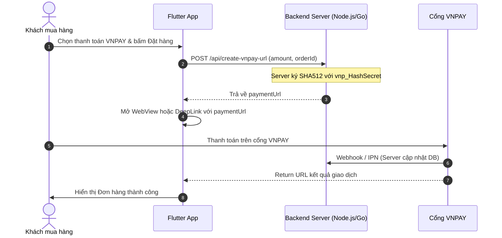

# Hướng Dẫn Tích Hợp Thanh Toán Online: VNPAY & VietQR

Dự án hiện đã tích hợp thành công 2 giải pháp thanh toán online phổ biến nhất tại Việt Nam ngay trên ứng dụng Flutter:
1. **VietQR (Napas 247)**: Tạo mã QR ngân hàng động theo chuẩn quốc gia theo số tiền và mã đơn hàng thực tế.
2. **Cổng thanh toán VNPAY (Simulator & Sandbox UI)**: Đầy đủ các phương thức quét VNPAY-QR, thẻ ATM nội địa (hỗ trợ nhập test OTP) và thẻ tín dụng quốc tế.

---

## 1. Cấu trúc mã nguồn đã tích hợp trên App

```
lib/features/payment/
├── domain/
│   ├── payment_types.dart         # Enum PaymentMethod (COD, VietQR, VNPAY) & PaymentStatus
│   └── vietqr_config.dart          # Cấu hình tài khoản ngân hàng & URL sinh mã VietQR
└── presentation/
    ├── vietqr_payment_screen.dart # Giao diện quét mã QR ngân hàng kèm sao chép STK, đếm ngược
    └── vnpay_payment_screen.dart   # Giao diện cổng thanh toán VNPAY (QR, Thẻ ATM Sandbox, Visa)
```

---

## 2. Cách thay đổi thông tin nhận tiền VietQR của Shop

Mở file [`lib/features/payment/domain/vietqr_config.dart`](vietqr_config.dart):

```dart
class VietQrConfig {
  const VietQrConfig({
    this.bankCode = 'MB',               // Mã ngân hàng: MB, VCB, TCB, ACB, BIDV, CTG...
    this.bankName = 'MBBank',           // Tên hiển thị
    this.accountNumber = '0988889999',  // SỐ TÀI KHOẢN NGÂN HÀNG CỦA BẠN
    this.accountHolder = 'LUMI MARKET', // TÊN CHỦ TÀI KHOẢN
    this.template = 'compact2',         // Giao diện khung QR của VietQR
  });
}
```

Mã QR tạo ra theo chuẩn `https://img.vietqr.io/image/<BANK>-<STK>-compact2.png?amount=<TIỀN>&addInfo=<NỘI_DUNG>`:
- Khách dùng bất kỳ app ngân hàng nào (Vietcombank, MB, Techcombank, BIDV, Cake...) quét mã sẽ tự động điền **đúng số tiền** và **đúng nội dung chuyển khoản**.

---

## 3. Khi bạn triển khai Backend thật cho VNPAY

Trong môi trường Production, để bảo mật chữ ký bí mật (`vnp_HashSecret`), luồng thanh toán VNPAY chuẩn như sau:



### Mã nguồn Node.js/Express mẫu tạo URL VNPAY:

```javascript
const crypto = require('crypto');
const querystring = require('qs');

function createVnpayUrl(req, res) {
    const tmnCode = 'YOUR_TMN_CODE';
    const secretKey = 'YOUR_SECRET_KEY';
    const vnpUrl = 'https://sandbox.vnpayment.vn/paymentv2/vpcpay.html';
    const returnUrl = 'yourapp://vnpay-return'; // Deeplink về app

    let vnp_Params = {
        'vnp_Version': '2.1.0',
        'vnp_Command': 'pay',
        'vnp_TmnCode': tmnCode,
        'vnp_Locale': 'vn',
        'vnp_CurrCode': 'VND',
        'vnp_TxnRef': req.body.orderId,
        'vnp_OrderInfo': 'Thanh toan don hang ' + req.body.orderId,
        'vnp_OrderType': 'other',
        'vnp_Amount': req.body.amount * 100, // VNPAY nhân 100
        'vnp_ReturnUrl': returnUrl,
        'vnp_IpAddr': req.ip || '127.0.0.1',
        'vnp_CreateDate': new Date().toISOString().replace(/[-:T]/g, '').slice(0, 14),
    };

    // Sắp xếp các tham số alphabet
    vnp_Params = sortObject(vnp_Params);

    const signData = querystring.stringify(vnp_Params, { encode: false });
    const hmac = crypto.createHmac('sha512', secretKey);
    const signed = hmac.update(Buffer.from(signData, 'utf-8')).digest('hex');
    vnp_Params['vnp_SecureHash'] = signed;

    const paymentUrl = vnpUrl + '?' + querystring.stringify(vnp_Params, { encode: false });
    res.json({ paymentUrl });
}
```

---

## 4. Tự động xác nhận giao dịch VietQR khi có Backend

Nếu bạn muốn khi khách quét VietQR chuyển tiền xong thì đơn hàng tự động chuyển sang "Đã thanh toán" (không cần khách bấm nút xác nhận thủ công):
- Bạn có thể kết nối cổng miễn phí / chi phí thấp như **PayOS** (https://payos.vn) hoặc **SePAY** / **Casso**.
- Khi tài khoản ngân hàng của bạn nhận được tiền có chứa nội dung `LUMI DEMO0001`, dịch vụ sẽ gửi Webhook tới Backend của bạn -> Backend đẩy WebSocket / Firebase Notification về App để tự động chuyển màn hình thành công tức thì!

